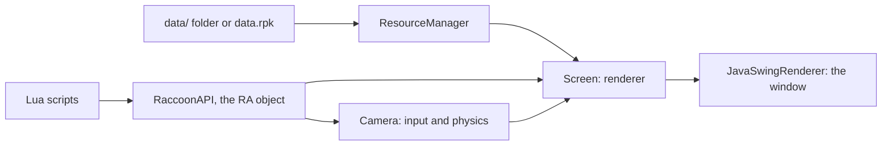

# Raccoon Engine

**A retro 2.5D game engine inspired by DOOM.** A multithreaded software raycaster written in Java, games scripted in Lua, and levels drawn in a browser-based map editor.

Worlds are built the way DOOM and the Build Engine built them: rooms with their own floor and ceiling heights, joined by openings you can see and walk through, filled with sprites drawn from eight viewing angles. Everything renders at 640 × 480 in a fixed 256-colour palette and is scaled up to fill your screen, so every game shares the same chunky retro look.

- [What's in this repo](#whats-in-this-repo)
- [Quick start](#quick-start)
- [The Releases folder](#the-releases-folder)
- [How the engine works](#how-the-engine-works)
- [Making a game](#making-a-game)
- [Lua API reference](#lua-api-reference)
- [Tips and gotchas](#tips-and-gotchas)
- [Extending the engine in Java](#extending-the-engine-in-java)
- [Limitations](#limitations)
- [License](#license)

## What's in this repo

| Path | What it is |
|---|---|
| `RaccoonEngineV2/` | The engine: Java source, the LuaJ library, and a small example game in `data/` |
| `RaccoonMapEditor/` | The level editor. Open `raccoon_editor.html` in a browser; nothing to install or build |
| `Releases/` | Games made with, or planned for, the engine: one playable demo, one earlier game, and design notes ([details](#the-releases-folder)) |
| `LICENSE` | MIT |

## Quick start

### Play the demo

You need **Java 21 or newer**; a JRE is enough. Check with `java -version`, and if you need one, [Eclipse Temurin](https://adoptium.net) is free.

```bash
cd Releases/Demo
java -jar game.jar
```

Run it from inside `Releases/Demo`: the engine looks for `data.rpk` in the folder you start it from. An `UnsupportedClassVersionError` means your Java is older than 21.

The demo is the example game from `RaccoonEngineV2/data`: a title screen with music, where **Enter** loads a small room with your coordinates in the corner, and **Esc** quits.

### Build and run from source

You need a **JDK 21 or newer**. From the repo root:

```bash
cd RaccoonEngineV2
javac --release 21 -cp lib/luaj-jse-3.0.2.jar -d bin src/raccoon/*.java
java -cp "bin:lib/luaj-jse-3.0.2.jar" raccoon.Main
```

On Windows, use `;` instead of `:` in the `-cp` path. `--release 21` keeps the output runnable on Java 21 even if you compile with a newer JDK.

In **Eclipse**, import `RaccoonEngineV2` (the project files are included) and run `raccoon.Main`. If you get `UnsupportedClassVersionError` mentioning class file version 69.0, `bin/` holds stale classes built by a newer JDK: run **Project → Clean**.

The engine opens a borderless window the size of your screen. It needs a desktop session, so it won't start on a headless server.

### Controls

These are built into the engine and work in every game:

| Input | Action |
|---|---|
| Mouse | Look around (click once to capture the mouse) |
| `W` `A` `S` `D` | Move and strafe |
| `←` `→` | Turn |
| `Page Up` / `Page Down` | Look up / down |
| `Space` | Jump, or fly up in fly mode |
| `Ctrl` | Fly down in fly mode |

Every other key, including Enter and Esc, is up to each game's scripts.

## The Releases folder

`Releases/` is part showcase, part sketchbook: one playable build, one earlier game, and concept material for games planned for the engine.

| Folder | What's inside | How to run |
|---|---|---|
| `Demo/` | The example game, packaged as `game.jar` + `data.rpk` | Java 21+: see [Play the demo](#play-the-demo) |
| `Viridium/` | An earlier game built on a previous version of the engine, with that engine's source and compiled classes | Java 21+: see below |
| `Aya Island/` | Design documents and concept art | Not a build |
| `Lone Gungirl/` | Art, sounds and Lua scripts written for the previous engine version | Not a build |
| Everything else | A concept note (`concept.txt` or `context.txt`) for a planned game, sometimes with early art | Not a build |

Viridium and Lone Gungirl use the previous engine's scripting API (`REAPI`), so their scripts don't run on `RaccoonEngineV2`. To run Viridium on its own engine:

```bash
cd "Releases/Viridium/Viridium-Game/files/RaccoonEngine"
mkdir data/sprites        # git doesn't keep empty folders, and this engine needs it (Windows cmd: mkdir data\sprites)
java -cp "bin:lib/*" Main # Windows: "bin;lib/*"
```

## How the engine works



The engine runs a fixed loop of 60 ticks per second. Each tick it renders the world, runs your scripts (which can draw UI on top), then reads input and moves the player.

### The world

A map is a grid. Each room is a **sector**: a floor height, a ceiling height, and a texture and brightness for each. The surfaces standing on grid lines are **edges**, and there are two kinds:

- A **world boundary** is the map's outer shell. It belongs to one sector and has a single texture.
- A **wall** sits between two sectors and has up to three textures: *bottom* where the floor steps up into the next room, *top* where the ceiling steps down, and *middle* across the opening itself, for glass, a fence or a grate. A wall can be solid or walk-through.

Rays carry on through walls into the next sector, which is what lets you see from room to room. The map editor cuts whatever rooms you draw into grid-aligned rectangles (Manhattan partitioning), so every sector is exactly one rectangle with one edge per side.

### Rendering

For every screen column, the engine casts a ray through the grid, drawing ceiling, walls and floor as it crosses each sector, with the columns split across all CPU cores. A ray stops at a world boundary, or as soon as a wall's opening is too small to see anything through. That makes the cost depend on how far you can see, not on how many sectors the map has.

Sprites are billboards with eight pre-drawn viewing angles, depth-tested per pixel against the walls. The skybox scrolls as you turn and slides as you look up and down. Every image is matched to the 256-colour palette when it loads, and lighting uses 32 brightness levels.

### Scripting

Games are written in Lua 5.2 (via LuaJ), and every script can use one global object, `RA`. The engine starts `data/scripts/init.lua` automatically; from there, scripts add and remove each other.

Each script is compiled once and keeps its own Lua environment between frames. A script can be written in one of two ways:

```lua
local timer = 0            -- setup: runs once, when the script is added

function update()          -- then this runs every frame
    timer = timer + 1      -- locals from setup keep their values
end
```

If a script doesn't define a global `update` function, the whole file runs every frame instead. That suits one-shot scripts like `init.lua`, which do their work and remove themselves.

### Assets

At startup the engine only builds a list of which assets exist. Each asset loads the first time something uses it, and stays in memory until a script unloads it. Assets come from a loose `data/` folder while you develop, or from a single `data.rpk` pack when you ship. When both exist, the folder wins.

### Source files

All in `RaccoonEngineV2/src/raccoon/`:

| File | Role |
|---|---|
| `Main.java` | Entry point: the 60-tick loop, the render thread pool, and `--pack` |
| `Table.java` | Constants and lookup tables: palette, shading, ray angles, screen scaling |
| `Screen.java` | The renderer: raycasting, walls, floors, ceilings, sky, sprites, the loading screen |
| `Camera.java` | Keyboard and mouse input, movement, gravity, collision |
| `Edge.java` | A surface on a grid line: a world boundary or a wall |
| `Sector.java` | A room: floor and ceiling heights, textures, bounding box |
| `Sprite.java` | A billboard entity |
| `Texture.java` | A palette-indexed image |
| `RaccoonAPI.java` | Everything Lua can call through `RA`, plus a zone for your own additions |
| `ScriptRunner.java` | Runs Lua: compiles each script once and keeps its environment |
| `ResourceManager.java` | The asset list, lazy loading, unloading, and loading-screen state |
| `Rpk.java` | Reads and writes `.rpk` packs |
| `Sound.java` | WAV playback |
| `Event.java` | An active script and its priority |
| `Renderer.java` | Interface for putting the finished frame on screen |
| `JavaSwingRenderer.java` | The window: scales each frame up to your screen |

## Making a game

A game is a `data/` folder of assets, maps and Lua scripts. The example in `RaccoonEngineV2/data` is a complete game in three short scripts, so read it alongside this section.

### 1. Set up the data folder

| Folder | Holds | Rules |
|---|---|---|
| `bgm/` | Music (`.wav`) | |
| `se/` | Sound effects (`.wav`) | |
| `fonts/` | Fonts (`.ttf`) | Drawn at 16 px |
| `maps/` | Maps (`.txt`) | Made in the editor |
| `scripts/` | Lua scripts (`.lua`) | Must include `init.lua` |
| `tex/` | Wall, floor and ceiling textures (`.png`) | Any size |
| `sprites/` | Sprite sheets (`.png`) | Width must be 8 × height: eight viewing angles side by side |
| `skybox/` | Sky images (`.png`) | Width 2560 (4 × 640); height at least 480, and 880 for the full look up/down range |
| `pics/` | UI images (`.png`) | |

Three rules to follow:

- **All nine folders must exist**, even empty ones, or the engine won't start. Git doesn't store empty folders, so keep at least one real asset of the right type in each.
- **Each folder may hold only its own file type.** Anything else, even a `.gitkeep` or the hidden `.DS_Store` that macOS creates, stops the engine with "unsupported file format".
- **Keep filenames unique across folders.** Assets are looked up by bare filename, so a `stone.png` in both `tex/` and `sprites/` means one silently hides the other.

### 2. Write the scripts

The example game hands control from script to script: `init.lua` → `menu.lua` → `game.lua`.

`data/scripts/init.lua` starts the music, adds the menu, and removes itself:

```lua
local script_index = ...
RA:systemDebug(false)
RA:audioPlayBGM("music.wav", true, 0.9)
RA:scriptAdd("menu.lua", 10)
RA:scriptEnd(script_index)
```

`menu.lua` draws a title screen every frame; Enter adds `game.lua` and removes the menu. `game.lua` loads the map behind a loading screen, places the player, then draws a coordinate HUD every frame:

```lua
local script_index = ...
local FONT = "system_font.ttf"
RA:worldLoadMapAsync("world.txt", "LOADING WORLD")
RA:playerSetPosition(10, 2, 10, 0)
RA:playerSetWalk(1.0, 0, 0)
RA:worldSetSkybox("default_sky.png", 0.5)
local function fmt(v) return string.format("%.1f", v) end
function update()
    if RA:loadingIsActive() then return end
    local x, y, z = RA:playerGetPosition(0), RA:playerGetPosition(1), RA:playerGetPosition(2)
    RA:uiFillRect(6, 6, 150, 56, 0, 0.35)
    RA:uiText("X " .. fmt(x), 12, 10, FONT, 0.6)
    RA:uiText("Y " .. fmt(y), 12, 26, FONT, 0.6)
    RA:uiText("Z " .. fmt(z), 12, 42, FONT, 0.6)
    if RA:inputGetKeyStatus(true, "esc") then RA:systemQuit() end
end
```

A script with an `update()` should end other scripts by name (`RA:scriptEndByName`): an index saved during setup can go stale once other scripts are removed.

### 3. Build maps in the editor

1. Open `RaccoonMapEditor/raccoon_editor.html` in a browser and click **NEW PROJECT**.
2. Draw a room: drag out its first side, then click each next corner. Sides snap to horizontal or vertical, and ending on the starting corner closes the room. **Delete** or **Backspace** removes the last side.
3. In the panel that opens, set the room's floor and ceiling heights, textures, and the walls on each side, then click **SAVE**.
4. Once every room is drawn, click **SAVE PROJECT**. The `.json` it saves is your editable source: exported maps can't be loaded back into the editor.
5. Click **DEFINE WORLD BOUNDARY** and draw the outer shell. It must start at the origin (0, 0), the bottom-left corner, with X increasing to the right and Z upward. Saving its settings partitions the map, which locks the canvas.
6. Click **DOWNLOAD MAP.TXT**, put the file in `data/maps/`, and load it from a script with `RA:worldLoadMapAsync("yourmap.txt", "LOADING")`.

Right-drag pans and the mouse wheel zooms. Every texture a map names must exist in `data/tex/`, or it shows as a magenta checkerboard. The editor previews textures from its own `RaccoonMapEditor/tex/` folder, so copy your textures there too.

### 4. The map format

The editor writes plain text, which you can also edit by hand:

```
[SIZE]
width height                    grid lines: the largest coordinate + 1

[SECTORS]                       one line per room
id floor ceil  ftex fbright ftile fskip  ctex cbright ctile cskip

[BOUNDARIES]                    one line per outer-shell segment
x1 z1 x2 z2 sector  tex bright tile skip

[EDGES]                         one line per wall between two sectors
x1 z1 x2 z2 sectorA sectorB  btex bbright btile bskip  mtex mbright mtile mskip  ttex tbright ttile tskip  solid
```

Brightness runs from 0 to 1, with **0.5 as the image's true colours**. Setting `skip` to `true` leaves that surface undrawn, so a skipped ceiling shows the sky. Segments must be horizontal or vertical, coordinates can't be negative, and sizes and heights go up to 2000. `[WALLS]` and `[PORTALS]` are still accepted as older names for `[BOUNDARIES]` and `[EDGES]`.

The example map, `data/maps/world.txt`, is one 20 × 20 room with a skipped ceiling:

```
[SIZE]
21 21
[SECTORS]
0 0 5 floor.png 0.5 1 false ceiling.png 0.4 1 true
[BOUNDARIES]
0 0 20 0 0 wall.png 0.5 1 false
0 20 20 20 0 wall.png 0.5 1 false
0 0 0 20 0 wall.png 0.5 1 false
20 0 20 20 0 wall.png 0.5 1 false
[EDGES]
```

### 5. Ship it

1. **Pack the assets.** Run the engine once with `--pack`. In Eclipse, add it under **Run Configurations → Arguments → Program arguments**; from a terminal, inside `RaccoonEngineV2`:

   ```bash
   java -cp "bin:lib/luaj-jse-3.0.2.jar" raccoon.Main --pack
   ```

   It writes `data.rpk` next to `data/` and exits. Pack again whenever an asset changes. Packing refuses to run without a `data/` folder, so a shipped game can't overwrite its own pack.

2. **Build a runnable jar.** In Eclipse, use **File → Export → Java → Runnable JAR file**, pick the `raccoon.Main` launch configuration, and choose **Extract required libraries into generated JAR**. Or, from a terminal on macOS or Linux, inside `RaccoonEngineV2`:

   ```bash
   javac --release 21 -cp lib/luaj-jse-3.0.2.jar -d build src/raccoon/*.java
   (cd build && jar xf ../lib/luaj-jse-3.0.2.jar && rm -rf META-INF)
   jar --create --file game.jar --main-class raccoon.Main -C build .
   ```

3. **Put `game.jar` and `data.rpk` in one folder**, the same layout as `Releases/Demo`. Players run `java -jar game.jar` from that folder, with Java 21 or newer.

The `.rpk` is a bundle, not protection: files are stored as-is, uncompressed and unencrypted. Java also grows its memory freely; to keep it in check, cap the heap when launching, for example `java -Xmx256m -jar game.jar`.

## Lua API reference

Every call uses Lua's colon syntax, for example `RA:systemLog("hello", "menu")`. Brightness values run from 0 to 1, with 0.5 as the true colours.

### System

| Call | What it does |
|---|---|
| `systemDebug(on)` | Shows or hides the on-screen debug console |
| `systemLog(msg, tag)` | Logs a message to the terminal and the on-screen console, while the console is on |
| `systemWorldTime()` | The current date and time, as a string |
| `systemStartTime()` | Whole seconds since the game started |
| `systemGetMaxFPS()` | The tick rate (60) |
| `systemGetFrameNumber()` | Ticks since the game started |
| `systemQuit()` | Closes the game |

### Scripts

| Call | What it does |
|---|---|
| `scriptAdd(name, priority)` | Runs a script every frame; lower priorities run first |
| `scriptEnd(index)` | Removes a script by its position in the running list |
| `scriptEndByName(name)` | Removes a script by filename |
| `scriptReload(name)` | Drops a script's compiled code and state; its next run re-reads the file and runs its setup again |

### World

| Call | What it does |
|---|---|
| `worldLoadMapAsync(map, text)` | Loads a map in the background, showing a loading screen with `text` |
| `worldLoadMap(map)` | Loads a map immediately, freezing the frame while it does |
| `worldSetSectorCountLimit(n)` / `worldGetSectorCountLimit()` | The sector cap (default 3400); raise it before loading a bigger map |
| `worldSetSkybox(image, brightness)` | Sets the sky image from `skybox/` |
| `worldSetSkyboxOffset(pixels)` | Shifts the sky horizontally |
| `worldSetSpriteRenderDistance(d)` / `worldGetSpriteRenderDistance()` | Sprites further away than this aren't drawn (default 64) |
| `worldSetPortalCollision(a, b, solid)` | Blocks or allows moving from sector `a` into sector `b`. It's one-way: call it again with `a` and `b` swapped to cover both directions |
| `worldChangeSectorVals(isFloor, sector, texture, brightness, tile, skip)` | Changes a sector's floor (`true`) or ceiling (`false`) at runtime |
| `worldChangeVerticalVals(x, z, axis, texture, skip, brightness, tile, band)` | Retextures one unit-long edge starting at grid point (`x`, `z`). `axis` is 0 for an edge along a line of constant X, 1 for constant Z. `band` is 0 bottom, 1 middle, 2 top; world boundaries only have a middle |

### Player

| Call | What it does |
|---|---|
| `playerSetPosition(x, y, z, dir)` | Teleports the player; coordinates can't be negative, and `dir` is in radians, from 0 up to 2π |
| `playerGetPosition(axis)` | Position on one axis: 0 = x, 1 = y, 2 = z |
| `playerGetDirection()` | Facing direction, in radians |
| `playerGetSector()` | The sector the player is standing in |
| `playerSetWalk(eyeHeight, bobSpeed, bobAmount)` | Walking mode: gravity, jumping and head-bob. The eye height is measured from the floor |
| `playerSetFly()` | Fly mode: no gravity; Space goes up, Ctrl goes down |
| `playerSetGravity(g)` / `playerGetGravity()` | Gravity strength |
| `playerSetMoveSpeed(s)` / `playerSetTurnSpeed(s)` / `playerSetPitchSpeed(s)` | Movement, turning, and look up/down speeds |

### Sprites

| Call | What it does |
|---|---|
| `entityUpsertSprite(id, x, y, z, size, brightness, image, script, radius, dir)` | Creates sprite `id`, or updates it if it exists. `image` is a sheet from `sprites/`, `script` is a behaviour script (or `nil`), and `radius` blocks the player (0 for none) |
| `entityRemoveSprite(id)` | Removes a sprite |
| `entityCount()` | How many sprites exist |

A behaviour script runs every frame for its sprite and receives the sprite's state as `...`, in this order: `x, y, z, size, brightness, image, id, radius, dir`. Sprites that share a behaviour script also share its Lua environment, so key any per-sprite state by `id`.

### Input

| Call | What it does |
|---|---|
| `inputGetKeyStatus(once, key)` | `true` while `key` is held; with `once` set to `true`, only on the frame it's pressed |
| `inputSetMouseSensitivity(s)` | Mouse look speed |

Key names: `a`–`z`, `0`–`9`, `f1`–`f12`, `space`, `enter`, `esc`, `shift`, `ctrl`, `alt`, `tab`, `backspace`, `delete`, `insert`, `home`, `end`, `pgup`, `pgdn`, `arrow_up`, `arrow_down`, `arrow_left`, `arrow_right`, `minus`, `plus`, `left_bracket`, `right_bracket`, `colon`, `quote`, `pipe`, `comma`, `dot`, `slash`, `tilde`, `mouse_left`, `mouse_right`, `mouse_wheel_up`, `mouse_wheel_down`.

### UI

These draw on top of the world, and are called from a script every frame. Coordinates are in the 640 × 480 game screen.

| Call | What it does |
|---|---|
| `uiText(text, x, y, font, brightness)` | Draws text in a font from `fonts/` |
| `uiTextDefault(text, x, y, brightness)` | The same, in `system_font.ttf` |
| `uiTextWidth(text, font)` | How wide the text is in pixels, for centring |
| `uiDraw(image, x, y, scale, brightness)` | Draws an image, usually from `pics/`; transparent pixels are skipped |
| `uiFillRect(x, y, w, h, color, brightness)` | A solid rectangle. `color` is an index into the xterm 256-colour palette: 0 black, 9 red, 10 green, 11 yellow, 12 blue, 15 white |
| `uiScreenWidth()` / `uiScreenHeight()` | 640 and 480 |

### Audio

WAV files only. On a machine with no sound device, audio calls do nothing and the game carries on.

| Call | What it does |
|---|---|
| `audioPlayBGM(file, loop, volume)` | Plays music from `bgm/`, replacing whatever is playing; volume runs from 0 to 1 |
| `audioChangeBGMVol(volume)` | Changes the music volume |
| `audioStopBGM()` | Stops the music |
| `audioPlaySE(file, loop, volume)` | Plays a sound effect from `se/`; playing the same file again restarts it |
| `audioChangeSEVol(file, volume)` | Changes one sound effect's volume |
| `audioStopSE(file)` | Stops one sound effect |
| `audioStopAll()` | Stops the music and every sound effect |

### Resources and loading

| Call | What it does |
|---|---|
| `resourceLoad(name)` | Loads an asset now, so it doesn't cause a hitch the first time it's used |
| `resourceLoadFolderAsync(folder, text)` | Loads a whole folder (`"tex"`, `"sprites"`, ...) in the background, behind a loading screen with a progress bar |
| `resourceUnload(name)` | Frees one asset; it reloads by itself if something uses it again |
| `resourceUnloadAll()` | Frees everything, and **also resets every running script** (see [Tips and gotchas](#tips-and-gotchas)) |
| `resourceIsLoaded(name)` / `resourceLoadedCount()` | What's currently in memory |
| `resourceValidateAll()` | Loads and size-checks every asset. Slow; meant for development |
| `resourcePackRpk()` | Writes `data/` out to `data.rpk`, the same as `--pack` |
| `loadingIsActive()` | `true` while a background load is running |
| `loadingProgress()` | From 0 to 1, or −1 when unknown, as for map loads |
| `loadingSetMessage(text)` | Changes the loading screen's text |

### Store and saves

| Call | What it does |
|---|---|
| `storeSet(key, value)` / `storeGet(key)` | A key–value store shared by every script |
| `storeClear()` | Empties the store |
| `storeSaveGameState(file)` / `storeLoadGameState(file)` | Writes the store to a text file and reads it back. Numbers, strings and booleans only; returns `true` on success |

## Tips and gotchas

- **Lua 5.2 has no `//` and no bitwise operators.** For integer division, use `math.floor(a / b)`.
- **Brightness 0.5 is true colour.** 1.0 is pure white.
- **Use `inputGetKeyStatus(true, key)` for menus and actions.** With `false`, it fires on every frame the key is held.
- **`update` must be a global function.** A `local function update()` isn't found, so the whole file runs every frame instead.
- **Ending a script doesn't reset it.** Add it again and it continues where it left off; call `RA:scriptReload(name)` first for a fresh start. A script that removes itself during setup shouldn't define `update()`.
- **`resourceUnloadAll()` resets every running script,** and their setup runs again on the next frame; the example's `game.lua` would reload its map. Between levels, prefer unloading specific assets.
- **Unload at transitions.** Anything unloaded while still on screen reloads on the next frame, which shows up as a hitch.
- **Behaviour scripts receive `brightness` as the internal 0–31 light level.** Divide it by 31 before passing it back to `entityUpsertSprite`.
- **Maps with more than 3400 sectors** need `RA:worldSetSectorCountLimit(n)` before they load.
- **Performance depends on sightlines.** Doors, corners and height changes stop rays early; huge open spaces are the slow case.
- **Every image is matched to 256 colours,** so gentle gradients band or flatten. Give sky art strong contrast.
- **If a map loads wrong or empty,** look for `[worldLoadMap] FAILED` in the terminal or Eclipse console.

## Extending the engine in Java

Any public method you add to `RaccoonAPI.java` becomes callable from Lua as `RA:yourMethod(...)` after a recompile, with no registration step. The **USER ZONE** at the bottom of the file is set aside for this and includes an example, `userExampleFunc()`. Fields on the class persist for the whole session, which makes Java the right home for anything that runs hot every frame or needs to remember things: pathfinding, inventories, damage tables. Start your method names with `user` so they never clash with engine calls added later.

## Limitations

- Walls are axis-aligned: no diagonals, no slopes, and no rooms above other rooms.
- Looking up and down shifts the horizon rather than truly tilting the camera, so the view skews near the limits.
- Rendering is CPU-only at a fixed 640 × 480 (set in `Main.java` at compile time) with a fixed 256-colour palette.
- Sprites are flat billboards, and sprite collision ignores height.
- Single-player only; there's no networking.
- It needs a desktop session, so it won't run on a headless server.

## License

MIT © 2025 Rafael Sanchez. See [LICENSE](LICENSE).
